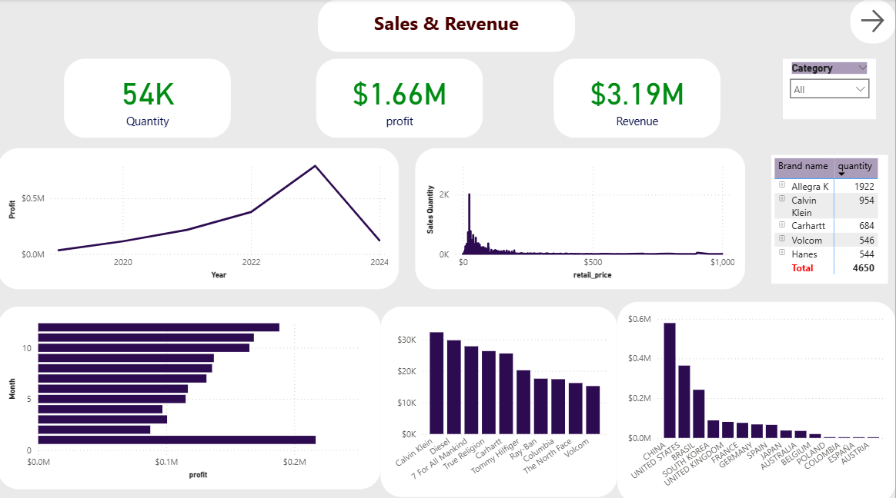
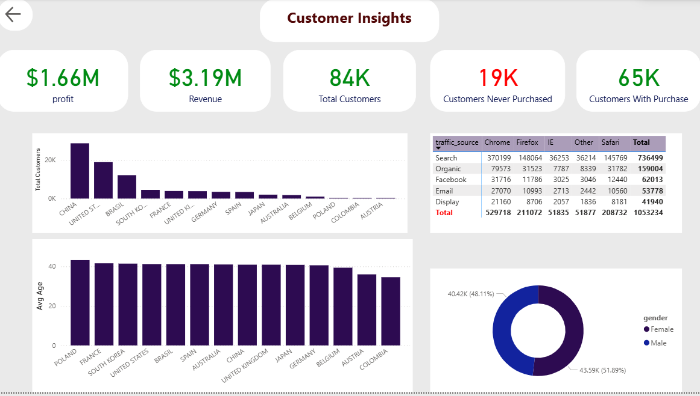
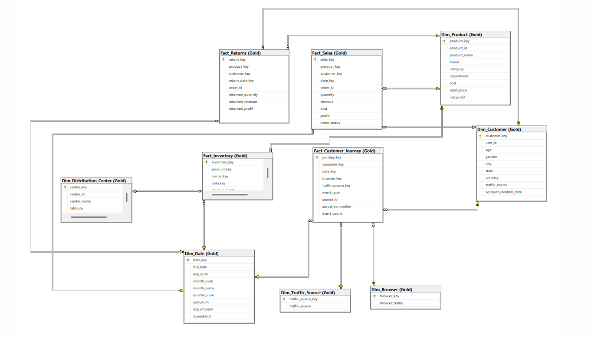

E-Commerce Data Analytics Project

End-to-End Data Warehouse & BI Solution

1-Overview

This project is a complete E-Commerce analytics platform built using a Data Warehouse and Power BI dashboards.
Raw transactional data is transformed into clean, analytics-ready data using modern data modeling and ETL practices.

2-Architecture

The solution follows Medallion Architecture:
Raw Data → Bronze → Silver → Gold → Power BI

The Gold Layer is modeled using a Galaxy Schema (multiple fact tables sharing common dimensions) to support scalable and flexible analytics.

Galaxy Schema :

3-BI Dashboards

The Gold layer feeds Power BI dashboards that provide:
Customer insights, 
Sales & revenue analysis, 
Product & country performance, 
Price vs sales analysis

4-Tech Stack

SQL (ETL & Data Modeling), 
Data Warehouse, 
Medallion Architecture, 
Galaxy Schema, 
Power BI
